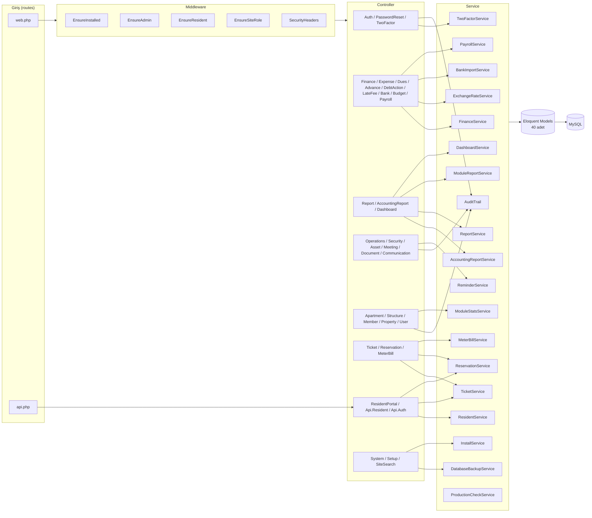
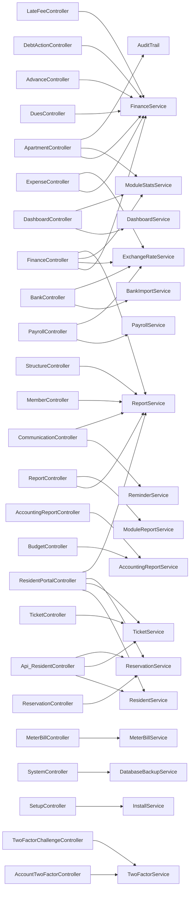
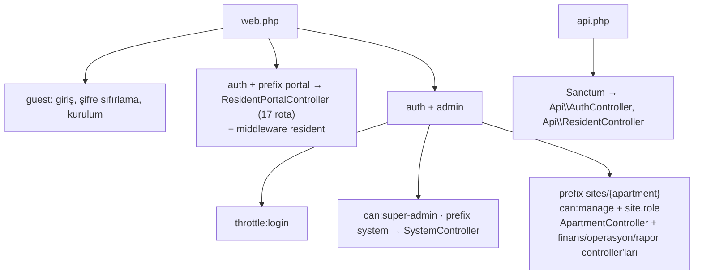
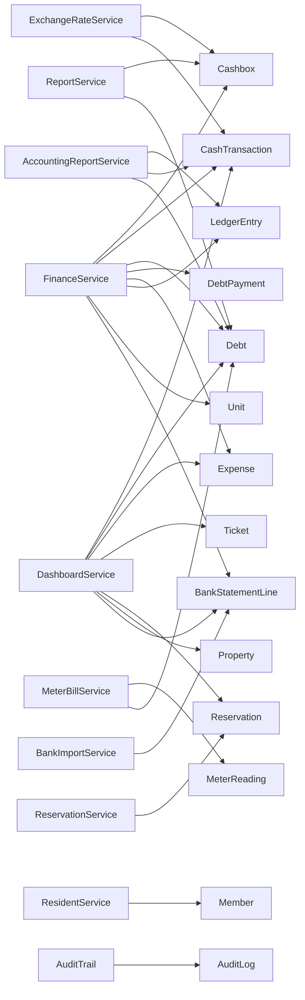

# Apartman Yönetim ve Muhasebe Sistemi — Proje Grafı

Laravel 13 · PHP 8.3+ · Sanctum (API) · Google2FA · PHPUnit 12  
Kaynak: `app/`, `routes/`, `database/migrations/` analizi (2026-11-11).

> Not: `graphify-out/` klasöründeki eski graf (8 Kasım, Windows'ta üretilmiş) 10 Kasım migration'larından
> önceki durumu gösterir ve güncel değildir. Bu dosya güncel koddan elle üretilmiştir.

## 1. Mimari katmanlar

## 2. Controller → Service bağımlılıkları

## 3. Rota grupları (web.php)

## 4. Veri modeli (ilişkiler)

```mermaid
erDiagram
    User ||--o{ Member : "hesap"
    User }o--o{ Apartment : "apartment_manager (role)"
    Apartment }o--|| User : "owner"
    Apartment ||--o{ Block : ""
    Block ||--o{ Unit : ""
    Apartment ||--o{ Unit : ""
    Apartment ||--o{ UnitGroup : ""
    Unit }o--o{ UnitGroup : "unit_group_unit"
    Unit ||--o{ Member : ""
    Apartment ||--o{ Member : ""

    Apartment ||--o{ Cashbox : ""
    Cashbox ||--o{ CashTransaction : ""
    Unit ||--o{ CashTransaction : ""
    Member ||--o{ CashTransaction : "payer"
    User ||--o{ CashTransaction : "performed_by"
    TransactionCategory ||--o{ CashTransaction : ""
    Debt ||--o{ CashTransaction : ""
    Apartment ||--o{ TransactionCategory : ""

    Unit ||--o{ Debt : ""
    TransactionCategory ||--o{ Debt : ""
    Debt ||--o{ DebtPayment : ""
    CashTransaction ||--o{ DebtPayment : ""
    Expense ||--o| Debt : "yeniden borçlandırma"

    Apartment ||--o{ Expense : ""
    Vendor ||--o{ Expense : ""
    Cashbox ||--o{ Expense : ""
    TransactionCategory ||--o{ Expense : ""
    Apartment ||--o{ Vendor : ""

    Apartment ||--o{ LedgerEntry : "çift taraflı kayıt"
    Apartment ||--o{ DuesDefinition : ""
    TransactionCategory ||--o{ DuesDefinition : ""
    TransactionCategory ||--o{ BudgetItem : ""
    Apartment ||--o{ BudgetItem : ""
    Apartment ||--o{ BankStatementLine : ""
    Cashbox ||--o{ BankStatementLine : ""
    CashTransaction ||--o| BankStatementLine : "eşleşme"

    Apartment ||--o{ Meter : ""
    Unit ||--o{ Meter : ""
    Meter ||--o{ MeterReading : ""
    Apartment ||--o{ MeterBill : ""

    Apartment ||--o{ CommonArea : ""
    CommonArea ||--o{ Reservation : ""
    Unit ||--o{ Reservation : ""
    User ||--o{ Reservation : ""
    Debt ||--o{ Reservation : "ücret"

    Apartment ||--o{ Ticket : ""
    Unit ||--o{ Ticket : ""
    User ||--o{ Ticket : ""
    Ticket ||--o{ TicketMessage : ""
    User ||--o{ TicketMessage : ""

    Apartment ||--o{ Meeting : ""
    Meeting ||--o{ MeetingAttendance : ""
    Unit ||--o{ MeetingAttendance : ""
    Meeting ||--o{ Decision : ""
    Apartment ||--o{ Poll : ""
    Poll ||--o{ PollOption : ""
    PollOption ||--o{ PollVote : ""
    Poll ||--o{ PollVote : ""

    Apartment ||--o{ Staff : ""
    Staff ||--o{ Task : ""
    Apartment ||--o{ Task : ""
    Apartment ||--o{ Asset : ""
    Vendor ||--o{ Asset : ""
    Apartment ||--o{ InventoryItem : ""
    Apartment ||--o{ SecurityEntry : ""
    Apartment ||--o{ Announcement : ""
    Apartment ||--o{ SiteNotification : ""
    Unit ||--o{ SiteNotification : ""
    Apartment ||--o{ Document : ""
    User ||--o{ Document : "uploaded_by"
    Apartment ||--o{ AuditLog : ""
    User ||--o{ AuditLog : ""
    User ||--o{ Property : "created_by"
```

## 5. Servis → Model etkileşimi (ana çekirdek)

## 6. Test kapsamı

- `tests/Feature` (45 dosya): finans (FinanceService, kısmi/yabancı para ödeme, dönem kapama, otomatik faturalama), muhasebe raporları, portal/API, 2FA, kurulum, yedekleme, denetim izi, sayaç/rezervasyon, destek talepleri.
- `tests/Unit` (3 dosya): Money yazıyla tutar, ekstre tutar ayrıştırma.

## Gözlemler

- Merkez model **Apartment** (site); neredeyse tüm tablolar `apartment_id` ile ona bağlı (çok kiracılı yapı, `scopeBindings` + `can:manage`).
- Finans çekirdeği: **FinanceService** → `Debt → DebtPayment → CashTransaction → LedgerEntry` zinciri; `Expense` yeniden borçlandırma ile `Debt`'e dönüşebilir.
- `Property` modeli `apartment_id` taşımıyor (yalnızca `created_by`); site kapsamı dışında ayrı bir modül.
- Yetki katmanı üç kademeli: `super-admin` (sistem), `manage` + `site.role` (site yöneticisi rolleri, `SitePermissions`), `resident` (portal).
